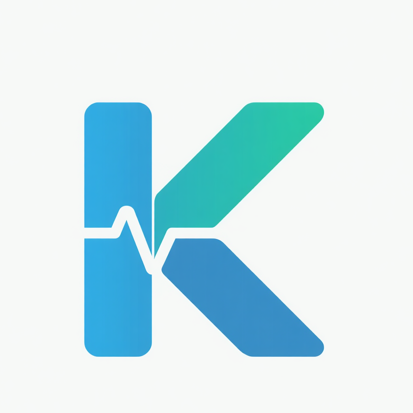
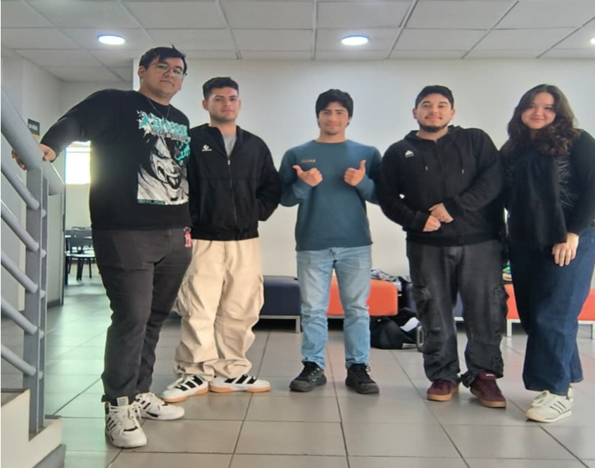

  
  <h1>Kura · CESFAM Providencia</h1>
  

    <strong>Capstone Grupo 3 — Gestión Predictiva, Omnicanal y Check-In Tótem SOME</strong> 
    Desafío 07 · Salud Pública (Reducción de Inasistencia a Citas Odontológicas)
  

  

    
    
    
    
    
  

  

    <a href="./Kura"><strong>Explorar Plataforma Kura</strong></a> ·
    <a href="./Bit%C3%A1coras%20de%20reuni%C3%B3n"><strong>Bitácoras de Reunión</strong></a> ·
    <a href="#equipo-y-compromisos-smart"><strong>Equipo Grupo 3</strong></a>
  

---

## Definición del Desafío

**Desafío 07 – Salud Pública:** Reducción de la inasistencia a citas médicas (*No Show* / NSP) en el sistema de atención primaria de salud (APS).

| Dimensión | Descripción |
| :--- | :--- |
| **Cliente** | **CESFAM de Providencia** (Enfoque piloto en Unidad Dental y especialidades odontológicas). |
| **Problemática** | Un porcentaje relevante de pacientes no asiste a sus horas médicas agendadas, generando pérdida de recursos, listas de espera más extensas y menor acceso a atención para otros usuarios. |
| **Objetivo** | Diseñar e implementar una solución tecnológica y operativa que disminuya la tasa de inasistencia mediante recordatorios preventivos, confirmación omnicanal, acreditación rápida en tótem y reasignación exprés (*Slot-Filling*). |

### Arquitectura de la Solución (`./Kura`)

| Módulo | Capacidad Principal |
| :--- | :--- |
| **Motor Predictivo (XGBoost)** | Calcula el riesgo de inasistencia (NSP) según historial clínico, distancia territorial, tramo FONASA y estado de confirmación T-24h. |
| **Bandeja Omnicanal IA** | Clasifica respuestas de WhatsApp y notas de voz, detecta barreras de movilidad (Ley Preferente 20.584) y actualiza la agenda en tiempo real. |
| **Tótem Presencial ESP32-CAM** | Escanea el QR de la cédula chilena (SIDIV Registro Civil), valida Dígito Verificador Módulo 11 y bloquea registros duplicados. |
| **Agenda Odontológica & Slot-Filling** | Organiza bloques dinámicos de 30, 45 y 60 minutos según especialidad y reasigna cupos liberados a la lista de espera priorizada. |

---

## Equipo y Compromisos SMART

  
  
<strong>Grupo 3:</strong> Alonso Sánchez · Lucas Calquín · Martín Riquelme · Matías Muñoz · Nicole Moreno

| Integrante | Compromiso SMART Declarado |
| :--- | :--- |
| **Lucas Calquín** | Encargarse de la parte técnica/desarrollo del proyecto, cumpliendo con las tareas de programación asignadas en cada etapa y avisando a tiempo si necesita ayuda. |
| **Nicole Moreno** | Ser el contacto principal con el cliente (CESFAM de Providencia), coordinando para ir revisando que el proyecto vaya por buen camino. |
| **Matías Muñoz** | Encargarse de que la solución se vea bien y sea fácil de usar, mostrando avances de diseño al equipo antes de cada entrega. |
| **Martín Riquelme** | Investigar información y datos que sirvan para entender mejor el problema, compartiéndolos con el equipo antes de cada reunión importante. |
| **Alonso Sánchez** | Encargarse de organizar al equipo (tareas, plazos, reuniones), avisando con anticipación si algo se está atrasando. |

---

## Contrato de Equipo

### Valores del Equipo

| Valor | Acuerdo de Convivencia |
| :--- | :--- |
| **Compromiso** | Cumplir con los plazos y tareas acordadas, avisando a tiempo si surge algún impedimento. |
| **Comunicación abierta** | Compartir avances, dudas y problemas apenas surgen, sin esperar a las reuniones. |
| **Respeto** | Valorar las opiniones de cada integrante y llegar a acuerdos por consenso. |
| **Colaboración** | Apoyarse mutuamente cuando alguien tiene sobrecarga de trabajo o dificultades técnicas. |
| **Responsabilidad** | Hacerse cargo de las tareas asignadas y de la calidad del trabajo entregado. |

### Normas de Funcionamiento

1. **Reuniones semanales fijas:** Jueves de `14:00` a `16:40` hrs para revisar avances y bloqueos.
2. **Canal oficial:** Comunicación rápida y coordinación diaria mediante WhatsApp del equipo.
3. **Anticipación de inasistencias:** Avisar con al menos `24 horas` de anticipación si no se puede cumplir un compromiso o asistir a una reunión.
4. **Toma de decisiones:** Las decisiones importantes del proyecto se toman por consenso; si no hay acuerdo, se vota por mayoría.
5. **Control de calidad:** Revisión cruzada entre integrantes antes de entregar cualquier avance al profesor guía.
